# Awesome-Geological-Modeling-Spatial-Stratigraphy

  

  
  
  
  
  

# 🪨 Top Geological Modeling & Spatial Stratigraphy

**Curated List of SaaS/Commercial Platforms & Open-Source GitHub Projects**  
*Focused on 3D Implicit Geological & Stratigraphic Modeling (GemPy, LoopStructural, strata), Borehole/Well-Log Analysis (striplog, welly), Geostatistics & Kriging (PyKrige, GSTools) & Geophysical/Subsurface Visualization (SimPEG, PyVista)*  
**Last updated: November 2026**

This repository tracks notable **SaaS/Commercial platforms** and **open-source projects** for **Geological Modeling & Spatial Stratigraphy**. These tools power 3D implicit geological surface and fault modeling (`GemPy`, `LoopStructural`, `niko1221/strata`), borehole lithology and stratigraphic column logging (`striplog`, `welly`, `lasio`), spatial geostatistics and kriging (`GSTools`, `PyKrige`, `GeoStats.jl`), and geophysical inversion and subsurface VTK visualization (`SimPEG`, `PyVista`, `ParaView`) for geologists, hydrogeologists, mining engineers, and geotechnical researchers.

**Examples** include Seequent Leapfrog Cloud (Bentley Systems), Bentley PLAXIS (Bentley Systems), Bentley gINT / OpenGround (Bentley Systems), GeoStudio (Seequent / Bentley), Oasis montaj (Seequent / Bentley), Micromine Cloud (AspenTech / Emerson), Paradigm Cloud (AspenTech / Emerson), Datamine (Vela / Constellation Software), RockWorks (RockWare), and Strater (Golden Software) (the category leaders).

**🚀 Open-source emphasis**: This section is heavily expanded with every major active project for 3D implicit geological & stratigraphic modeling (`niko1221/strata`, `GemPy`, `LoopStructural`, `pynoddy`), borehole & stratigraphic log processing (`striplog`, `welly`, `lasio`, `bruges`), spatial geostatistics & kriging (`GSTools`, `PyKrige`, `GSLIB` / `GeostatsPy`, `GeoStats.jl`), geophysical inversion (`SimPEG`, `pyGIMLi`, `Fatiando a Terra`), and subsurface 3D visualization (`PyVista`, `QGIS`, `ParaView`) — ideal for geoscientists building reproducible, open subsurface workflows without five-figure annual seat fees.

🤝 Contributions welcome! Open a PR to add/update entries. Keep descriptions factual and link to official sites.

## 📑 Table of Contents
- [📊 Sector Overview & Market Dynamics](#-sector-overview--market-dynamics)
- [☁️ SaaS/Hosted & Commercial Platforms](#️-saashosted--commercial-platforms)
- [💻 Open-Source GitHub Projects](#-open-source-github-projects)
- [🛠️ How to Contribute](#️-how-to-contribute)
- [⚠️ Disclaimer](#️-disclaimer)
- [💖 Support & Thank You](#-support--thank-you)

## 📊 Sector Overview & Market Dynamics

The global Geological Modeling, Subsurface Simulation & Mining/Geotechnical Software market is valued at approximately **$5.8B–$7.4B+ in 2026**, expanding at a ~10%–14% CAGR driven by critical minerals exploration, geothermal/CCS subsurface characterization, and civil infrastructure digital twins. The commercial enterprise layer exhibits **heavy winner-take-most consolidation** around Bentley Systems (which acquired Seequent, Leapfrog, GeoStudio, Oasis montaj, and PLAXIS) and Emerson / AspenTech (Micromine, Paradigm), whereas the **scientific Python/Julia computational geology, implicit structural modeling, and geostatistics ecosystems are rapidly advancing through open-source software** (`GemPy`, `LoopStructural`, `SimPEG`, `GSTools`, `PyVista`, `QGIS`).

## ☁️ SaaS/Hosted & Commercial Platforms

*Sorted descending by company valuation / annual revenue scale.*

| Platform | Description | Company Scale (Valuation / Revenue) | Starting Paid Tier | Free Tier / Trial Limit |
| :--- | :--- | :--- | :--- | :--- |
| **[Datamine (Studio RM / Strat3D)](https://dataminesoftware.com)** | Global mining and geological software suite offering 3D resource modeling, Strat3D bedded stratigraphic deposit modeling, and grade control. | **Part of Vela / Constellation Software** (~$60B+ market cap; ~$9B+ annual revenue) | **~$5,000 – $12,000+ / user / year** indicative commercial subscription | **Guided Commercial Demo / Academic Licensing** (No perpetual self-serve free tier; university teaching licenses available) |
| **[Micromine Cloud / Micromine Origin & Beyond](https://micromine.com)** | Comprehensive 3D geological modeling, resource estimation, stratigraphic seam modeling, and mine planning suite with cloud collaboration. | **Part of AspenTech / Emerson** (~$17B+ Emerson Electric annual revenue; acquired for ~$623M) | **~$5,000 – $12,000+ / user / year** indicative commercial module subscription | **Guided Commercial Evaluation / Academic Program** (No perpetual public free tier; free licensing for accredited mining/geology universities) |
| **[Paradigm Cloud / Aspen Subsurface (AspenTech)](https://aspentech.com)** | Enterprise seismic interpretation, structural/stratigraphic reservoir modeling (SKUA-GOCAD), and formation evaluation cloud software. | **Part of AspenTech / Emerson** (~$17B+ Emerson annual revenue; ~$1.1B+ AspenTech annual revenue) | **~$15,000+ / user / year** indicative enterprise subsurface license | **Enterprise Proof-of-Concept & University Grants** (No self-serve free tier; academic consortium licenses available) |
| **[Seequent Leapfrog Cloud & Central (Bentley Systems)](https://seequent.com)** | Industry-standard 3D implicit geological modeling, dynamic borehole updating, and cloud model-versioning platform for mining, civil, and geothermal projects. | **Part of Bentley Systems** (~$15B+ market cap; acquired for $1.05B; ~$1.35B+ annual revenue) | **~$8,000 – $15,000+ / user / year** indicative commercial subscription (includes Seequent Central cloud sync) | **Free Leapfrog Viewer & Guided Commercial Trial** (Free 3D Leapfrog Viewer app for inspecting `.lfview` models; free academic licenses for universities) |
| **[Bentley PLAXIS](https://bentley.com)** | Flagship 2D and 3D geotechnical finite-element deformation, soil-structure interaction, slope-stability, and groundwater flow modeling suite. | **Part of Bentley Systems** (~$15B+ public market cap on NASDAQ; ~$1.35B+ annual revenue) | **~$4,500 – $12,000+ / user / year** indicative Virtuoso/SELECT commercial subscription | **Free 14-Day Virtuoso Trial & Student Edition** (14-day full evaluation via Virtuoso practitioner trial; free academic licenses for students/faculty) |
| **[Bentley gINT / OpenGround](https://bentley.com)** | Cloud-connected geotechnical data management, borehole stratigraphy logging, and subsurface cross-section reporting platform (OpenGround succeeded legacy gINT). | **Part of Bentley Systems** (~$15B+ public market cap on NASDAQ; ~$1.35B+ annual revenue) | **~$3,000 – $6,500+ / user / year** indicative OpenGround Cloud subscription | **Guided Enterprise Trial & Academic Access** (14 to 30-day guided evaluation; no perpetual self-serve free tier; university academic licensing available) |
| **[GeoStudio (Seequent / Bentley Systems)](https://seequent.com)** | Integrated geotechnical and geo-environmental modeling suite for slope stability (SLOPE/W), groundwater seepage (SEEP/W), and thermal/contaminant transport. | **Part of Seequent / Bentley Systems** (~$15B+ parent market cap; ~$1.35B+ parent annual revenue) | **~$3,500 – $8,000+ / user / year** indicative commercial subscription | **Free GeoStudio Viewer & 14-Day Free Trial** (Free viewer mode for opening and inspecting existing GeoStudio files; 14-day fully-featured evaluation + student edition) |
| **[Oasis montaj (Seequent / Bentley Systems)](https://seequent.com)** | Enterprise geophysical, geochemical, and geological mapping and 3D subsurface inversion platform for mineral exploration and earth sciences. | **Part of Seequent / Bentley Systems** (~$15B+ parent market cap; ~$1.35B+ parent annual revenue) | **~$6,000 – $14,000+ / user / year** indicative commercial subscription | **Free Oasis montaj Viewer & 14-Day Trial** (Free downloadable viewer for Geosoft grids/databases; 14-day commercial trial + academic research licensing) |
| **[RockWorks (RockWare)](https://rockware.com)** | Integrated geological data management, borehole log plotting, 3D stratigraphic fence diagrams, solid voxel modeling, and hydrogeology suite. | **~$5M – $15M Est. Scale** (Profitable 40+ year independent geoscience software company) | **$1,500 – $5,000** starting commercial single-user license (Basic to Advanced tiers) | **14-Day Full-Access Free Trial** (14 days of full borehole database, 3D stratigraphy, and cross-section modeling during evaluation) |
| **[Strater (Golden Software)](https://goldensoftware.com)** | Subsurface well-log, stratigraphic column, and borehole cross-section visualization package for environmental and geotechnical professionals. | **~$3M – $8M Est. Scale** (Privately held engineering & mapping software vendor founded in 1983) | **$449 one-time license** (or ~$659/yr flagship suite) | **14-Day Free Trial** (14-day evaluation with full borehole cross-section and log generation tools) |
